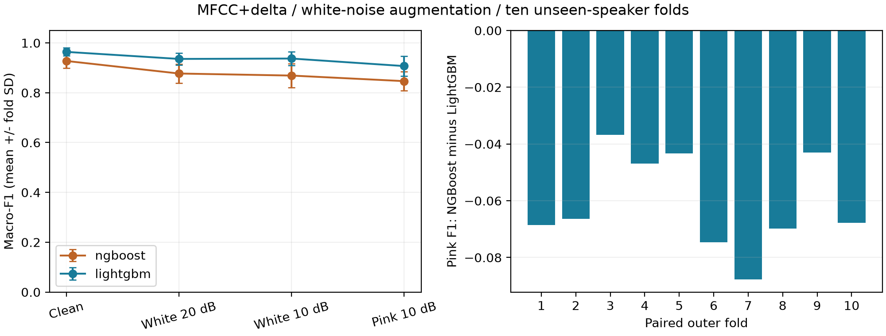

# NGBoost 与 LightGBM：实际训练结果

范围：MFCC+delta，干净＋10 dB 白噪声增强；外层十折、内层三折，测试说话人未参与训练。每对模型在同一 GitHub runner 顺序运行。

所有均值与 SD 均由十个外折计算；SD 不是独立置信区间。差值为 NGBoost − LightGBM。

| 条件 | NGBoost macro-F1 | LightGBM macro-F1 | 配对差值 | NGBoost 胜出 |
|---|---:|---:|---:|---:|
| Clean | 0.9275 ± 0.0282 | 0.9640 ± 0.0158 | -0.0365 ± 0.0154 | 0/10 |
| White 20 dB | 0.8772 ± 0.0380 | 0.9357 ± 0.0238 | -0.0586 ± 0.0172 | 0/10 |
| White 10 dB | 0.8689 ± 0.0478 | 0.9373 ± 0.0268 | -0.0684 ± 0.0233 | 0/10 |
| Pink 10 dB | 0.8466 ± 0.0374 | 0.9071 ± 0.0399 | -0.0605 ± 0.0168 | 0/10 |



## 概率质量与成本

| 指标 | NGBoost | LightGBM |
|---|---:|---:|
| Pink-10 accuracy | 0.8472 ± 0.0378 | 0.9069 ± 0.0400 |
| Pink-10 macro_precision | 0.8618 ± 0.0331 | 0.9185 ± 0.0316 |
| Pink-10 log_loss | 0.4910 ± 0.1063 | 0.3477 ± 0.1156 |
| 最终拟合秒/折 | 740.44 | 8.20 |
| 完整流程秒/折 | 2181.04 | 67.30 |
| 保存模型字节/折 | 2595865.40 | 659270.40 |

NGBoost / LightGBM 的平均最终拟合时间比为 90.26。完整流程还包括内层搜索、验证预测、保存与重载核验，两种方法的实际拟合调用次数不同；不能把流程时间当作一次拟合时间。

## 稳定性和支持范围

NGBoost 的平均粉红噪声 macro-F1 低于 LightGBM；十折中 NGBoost 胜出 0 折，差值范围 [-0.0878, -0.0367]。这是当前配置的观测结果，不能推广为 NGBoost 算法普遍更差；小均值差或折间胜负混合时，尤其不能仅凭均值宣称可靠优势。
粉红噪声 log loss 的配对差值为 +0.1433 ± 0.0405（越低越好），NGBoost 在 0/10 折胜出。log loss 不能单独证明校准。
粉红噪声 F1 的折间 SD 为 NGBoost 0.0374、LightGBM 0.0399。本次没有失败折，两种模型的训练警告记录均为零；不能将较慢或较低均值等同于训练发散或普遍更不稳定。

## 参数审查和局限

- ngboost：网格 [50, 100, 200]，选择计数 [0, 0, 10]；中间值唯一众数：False；记录警告数：0。
  NGBoost 存在选中最大轮数的折，说明此预算内可能仍受轮数限制；不能声称已经找到其最佳配置。若调整范围，需要在内层重新选择并对再次探索的局限作说明，最好采用新的外部测试。
  该 NGBoost 配置未通过课程“中间参数最常选”的检查，应作为披露局限的补充对比，不能标为全面合规或据此替换已核验的正式三模型。
- lightgbm：网格 [0.0, 0.1, 1.0]，选择计数 [3, 6, 1]；中间值唯一众数：True；记录警告数：0。

这是一个外层划分、固定噪声样本、单种特征与增强方式的比较。未测峰值内存、实际设备延迟或电量，也未做真实背景声和新麦克风测试。自然梯度、线搜索、树数量和实现差异可能解释成本，但本实验没有拆分这些机制，不能将耗时差全部归因于某一项。

原三模型主实验保持不变；这里训练二十个外折模型，没有为 NGBoost 另外训练全数据部署模型。

数据文件：summary.csv、paired_differences.csv、comparison.json、逐折 result.json 及 Actions 工件中的预测和模型。

## 复现来源与核验

[成功的 GitHub Actions 运行 38150310147](https://github.com/wengyinz1232-create/audiomnist-noise-robustness/actions/runs/38150310147)，训练提交 `e2c58ebc1a800900d10051eda1f0f24e5d40397e`。完成十折共二十个外层模型；NGBoost 内层复用阶段前缀，因此总计 140 次实际 fit 调用，评估 180 组内层候选分数。全部模型在云端保存、重载并核验预测；下载后又在本地从保存概率重新计算指标，通过完整配对与哈希检查。

本目录长期保存 [汇总指标](reports/summary.csv)、[配对差值](reports/paired_differences.csv)、[参数审查与核验](reports/comparison.json)、[逐折结果与预测](comparison/)、[运行记录](run.json)。预测文件不含原始音频或特征。模型 pickle 留在运行工件中（保留 14 天），另已下载完整证据备份；不要加载来源不可信的 pickle。

在仓库根目录安装实验依赖后，可直接复算本目录：

```bash
python compare_ngboost.py summarize --work-dir reproduced_results/ngboost-38150310147
python report_ngboost.py reproduced_results/ngboost-38150310147 analysis-output
```

第一个命令会在结果目录放置匹配的核心代码并重建 reports，不会重新训练；第二个命令生成中文分析和图表。完整重训见 [实验说明](../../docs/NGBOOST_EXPERIMENT.md)。

这些观测支持在当前配置和预算下保留 LightGBM，但不支持“NGBoost 永远更差”“NGBoost 已发生训练发散”或“NGBoost 已完成充分调参”的说法。
