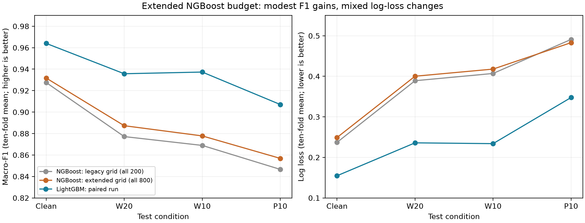

# NGBoost 扩展轮数实验：200 / 400 / 800

**结论：增加轮数带来小幅分类收益，但在当前协议下未追上 LightGBM，计算成本明显增加。十折全部由内层搜索选中 800 轮，仍触及搜索上界；不能声称 NGBoost 已充分调参，也未满足“中间参数最常选”检查。**

本实验保持学习率 0.03、深度 3、叶节点最少 20 样本、行/列采样各 0.5、MFCC+delta、干净与 W10 增强及原选参目标不变；采用十折外层、三折内层的说话人隔离验证。内层按 clean/W10 平均 Macro-F1 在 [200,400,800] 选择，选定后重新拟合外折模型。不是事先强制每折 800 轮。

## 相比历史 200 轮预算的收益

历史网格为 [50,100,200]，十折全部选 200；新网格为 [200,400,800]，十折全部选 800。两次云端特征文件 SHA-256、外层与内层说话人划分一致，固定参数一致。新一轮 LightGBM 的逐折 F1 和 log loss 与历史结果完全相同。以下为十折均值，变化单位为百分点。

| 测试条件 | 旧 NGBoost 200 | 新 NGBoost 800 | F1 增益（百分点） | 同轮 LightGBM |
|---|---:|---:|---:|---:|
| Clean | 0.9275 | 0.9317 | +0.42 | 0.9640 |
| White 20 dB | 0.8772 | 0.8873 | +1.01 | 0.9357 |
| White 10 dB | 0.8689 | 0.8778 | +0.89 | 0.9373 |
| Pink 10 dB | 0.8466 | 0.8569 | +1.03 | 0.9071 |

新 NGBoost 与 LightGBM 的 F1 差距仍为 3.23–5.95 个百分点；四种条件下 LightGBM 均在十折全部胜出。相对旧预算，NGBoost 在 Clean/W20/W10/P10 分别有 9/10、10/10、9/10、9/10 折的 F1 提高。



## 概率损失并未同步改善

| 测试条件 | 旧 NGBoost log loss | 新 NGBoost log loss | 新−旧（越低越好） | 同轮 LightGBM |
|---|---:|---:|---:|---:|
| Clean | 0.2370 | 0.2490 | +0.0120 | 0.1547 |
| White 20 dB | 0.3891 | 0.4002 | +0.0111 | 0.2359 |
| White 10 dB | 0.4070 | 0.4178 | +0.0108 | 0.2339 |
| Pink 10 dB | 0.4910 | 0.4830 | -0.0080 | 0.3477 |

增加轮数后，干净及两种白噪声的平均 log loss 略升，粉红噪声略降。因此不能把 F1 提高写成概率质量全面提升；内层优化的是 F1，并非 log loss。本实验没有单独测量概率校准质量。

## 时间与计算预算

| 指标 | 历史 NGBoost | 新 NGBoost | 本次 LightGBM |
|---|---:|---:|---:|
| 最终拟合秒/折 | 740.44 | 3074.39 | 8.24 |
| 完整选参及评估流程秒/折 | 2181.04 | 9058.52 | 67.67 |
| 保存模型字节/折 | 2595865.40 | 10340573.20 | 659270.40 |

本次 NGBoost 最终拟合平均约 51.24 分钟/折，对应 LightGBM 8.24 秒/折，平均时间比约 373.32 倍。NGBoost 完整流程平均约 151 分钟/折。十折并行运行，云端从启动到全部训练完成约 3 小时（2026-10-13 12:28–15:28，悉尼时间），不能把逐折耗时之和当作用户等待时间。

历史和新预算的计时来自不同 Actions 运行，不能将其比值解释成严格控制硬件的轮数效应；本次 NGBoost/LightGBM 是每折同一 runner 顺序测量。两者线程策略和算法实现不同，比较的是已声明的流水线。NGBoost 为 40 次实际拟合、LightGBM 为 100 次；每种模型均评估 90 个内层候选分数。保存模型大小不是峰值内存。

## 完成状态、证据与复算

训练提交：`1c5ed1eb08c90922f3be7def6672ede6cced73bb`。十个 paired-fold 任务全部成功，无缺失或被删除的折。GitHub 最后的 summarize 任务因账户付款/消费上限问题未启动，故整次 Actions 的状态仍是 failure；这不等于训练失败。已下载十个独立折工件，在本地使用原汇总程序完成复算，得到 `PAIRED_COMPARISON_VERIFIED`。未重跑训练或修改付费设置。原本的汇总工件 `ngboost-comparison-evidence` 因该任务未启动而没有生成，当前证据由十个 `paired-fold-*` 工件汇集。

- 所有保存的逐样本预测均重新计算指标；核对十折说话人覆盖、内外层隔离、选参和协议。
- 20 个模型的文件哈希全部通过；云端保存/重载检查全部通过。本地另对每个模型的前 16 条外折录音、四种条件重载核验，概率最大差约 1.11e-16。此处本地抽样重载与全部预测指标复算的范围不同。
- MFCC 特征文件 SHA-256：`3ef363daf025d4ba541a1ca9a03027c4a7a134d084409bf91a3519e1c7e6d3e5`。
- 逐折结果与概率在 `comparison/`；完整数值、配对差、旧新比较及本地模型审计在 `reports/`。运行状态和汇总失败原因保存在 `run.json`、`summary_job_annotations.json`。
- Git 仅保存派生预测及实验说明。20 个模型保存在本地交付 ZIP；没有上传模型或原始音频。没有训练额外的全数据部署模型。

在仓库根目录安装 `requirements-ngboost.txt` 后，无需模型或音频即可重新核验全部保存的预测指标：

```bash
python compare_ngboost.py summarize --work-dir reproduced_results/ngboost-38332286883 --protocol extended800
```

本实验属于对既有数据与已探索划分的补充分析，外层训练集重叠，折间 SD 和胜负计数是描述统计，不是独立置信区间或普遍优越性检验。当前结果支持在这份作业的指定范围内优先使用 LightGBM；NGBoost 作为更大计算预算的补充对照。进一步提高上限或改树结构，应另立内层方案，不能用这些外层结果持续调参后仍当作独立确认。课程报告正文未修改，旧实验和 legacy200 复现方式保留。

## 本次完整配对结果


范围：MFCC+delta，干净＋10 dB 白噪声增强；外层十折、内层三折，测试说话人未参与训练。每对模型在同一 GitHub runner 顺序运行。

所有均值与 SD 均由十个外折计算；SD 不是独立置信区间。差值为 NGBoost − LightGBM。

| 条件 | NGBoost macro-F1 | LightGBM macro-F1 | 配对差值 | NGBoost 胜出 |
|---|---:|---:|---:|---:|
| Clean | 0.9317 ± 0.0250 | 0.9640 ± 0.0158 | -0.0323 ± 0.0112 | 0/10 |
| White 20 dB | 0.8873 ± 0.0391 | 0.9357 ± 0.0238 | -0.0484 ± 0.0177 | 0/10 |
| White 10 dB | 0.8778 ± 0.0474 | 0.9373 ± 0.0268 | -0.0595 ± 0.0220 | 0/10 |
| Pink 10 dB | 0.8569 ± 0.0398 | 0.9071 ± 0.0399 | -0.0502 ± 0.0145 | 0/10 |

## 概率质量与成本

| 指标 | NGBoost | LightGBM |
|---|---:|---:|
| Pink-10 accuracy | 0.8572 ± 0.0395 | 0.9069 ± 0.0400 |
| Pink-10 macro_precision | 0.8706 ± 0.0342 | 0.9185 ± 0.0316 |
| Pink-10 log_loss | 0.4830 ± 0.1330 | 0.3477 ± 0.1156 |
| 最终拟合秒/折 | 3074.39 | 8.24 |
| 完整流程秒/折 | 9058.52 | 67.67 |
| 保存模型字节/折 | 10340573.20 | 659270.40 |

NGBoost / LightGBM 的平均最终拟合时间比为 373.32。完整流程还包括内层搜索、验证预测、保存与重载核验，两种方法的实际拟合调用次数不同；不能把流程时间当作一次拟合时间。

## 稳定性和支持范围

NGBoost 的平均粉红噪声 macro-F1 低于 LightGBM；十折中 NGBoost 胜出 0 折，差值范围 [-0.0712, -0.0306]。这是当前配置的观测结果，不能推广为 NGBoost 算法普遍更差；小均值差或折间胜负混合时，尤其不能仅凭均值宣称可靠优势。
粉红噪声 log loss 的配对差值为 +0.1353 ± 0.0478（越低越好），NGBoost 在 0/10 折胜出。log loss 不能单独证明校准。
粉红噪声 F1 的折间 SD 为 NGBoost 0.0398、LightGBM 0.0399。本次没有失败折，两种模型的训练警告记录均为零；不能将较慢或较低均值等同于训练发散或普遍更不稳定。

## 参数审查和局限

- ngboost：网格 [200, 400, 800]，选择计数 [0, 0, 10]；中间值唯一众数：False；记录警告数：0。
  NGBoost 存在选中最大轮数的折，说明此预算内可能仍受轮数限制；不能声称已经找到其最佳配置。若调整范围，需要在内层重新选择并对再次探索的局限作说明，最好采用新的外部测试。
  该 NGBoost 配置未通过课程“中间参数最常选”的检查，应作为披露局限的补充对比，不能标为全面合规或据此替换已核验的正式三模型。
- lightgbm：网格 [0.0, 0.1, 1.0]，选择计数 [3, 6, 1]；中间值唯一众数：True；记录警告数：0。

这是一个外层划分、固定噪声样本、单种特征与增强方式的比较。未测峰值内存、实际设备延迟或电量，也未做真实背景声和新麦克风测试。自然梯度、线搜索、树数量和实现差异可能解释成本，但本实验没有拆分这些机制，不能将耗时差全部归因于某一项。

原三模型主实验保持不变；这里训练二十个外折模型，没有为 NGBoost 另外训练全数据部署模型。

数据文件：reports/summary.csv、reports/paired_differences.csv、reports/comparison.json 与 comparison/fold_*/result.json；逐样本预测保存在同一折目录，模型另见本地交付 ZIP。
